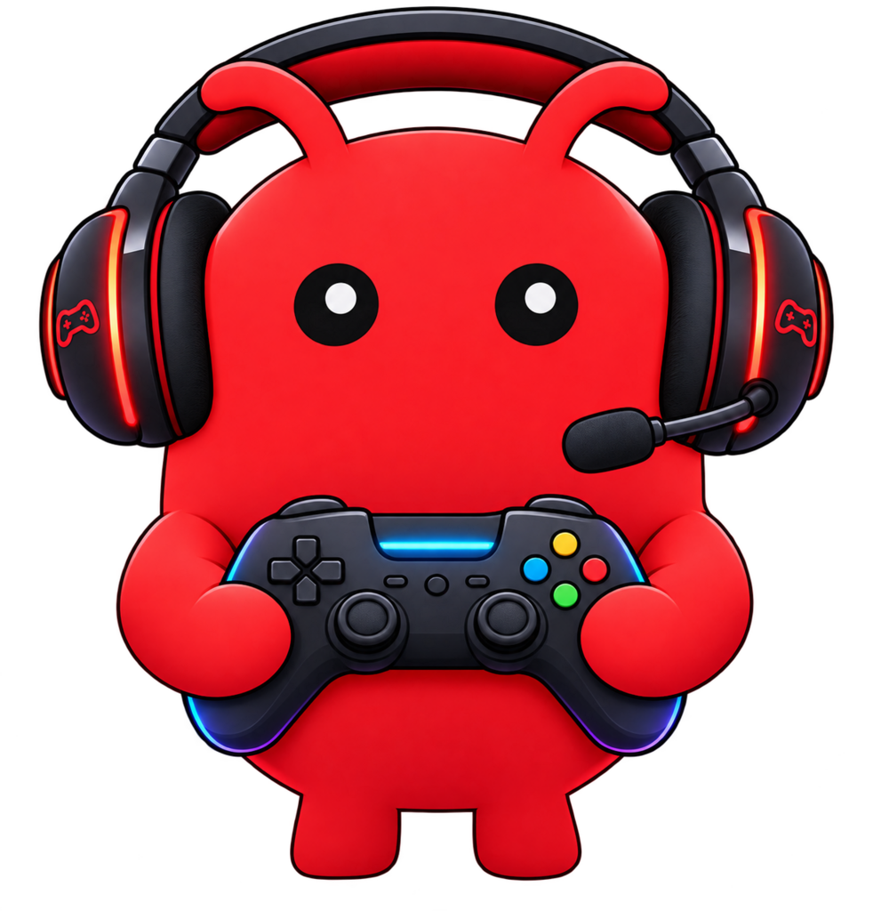

# Gaming Companion — OpenClaw gamer agent Template

<p align="center"></p>

A co-op buddy for your games backlog. Gaming Companion:

- **Picks what to play** based on your mood, the time you have, and how you rated past games.
- **Remembers where you left off** and gives a spoiler-safe "where was I?" recap when you come back.
- **Gets you unstuck** with a hint ladder (nudge → hint → steps → full solution) that only goes further when you ask.
- **Plans builds and completion runs**: loadouts tied to the current patch, patch-impact checks, and achievement routes with missables first.
- **Sends a weekly digest** of wishlist price drops, upcoming releases and patch notes. It's installed paused; Gaming Companion offers to turn it on.

Everything is stored as plain Markdown in the agent workspace (`games.md`, `wishlist.md`, `journal.md`, `player-profile.md`, `sources.md`, `sessions/`). `sources.md` is a curated list of trusted sites per game (meta and build sites, stat trackers, price trackers, completion guides) that the agent checks before a general web search. It also adds sites to the list as it finds them. It needs no API keys or plugins. Live prices, patches and release dates come from the agent's normal web lookup.

## Guardrails

Spoilers are off by default. It never buys, signs in to stores, handles payments or messages other people. It won't make up prices or dates, and it won't help with cheats in online or competitive play.

## Layout

```
gaming-companion/
├── package.json            # openclaw.template → CLAW.md
├── CLAW.md                 # manifest frontmatter + agent prompt (becomes SOUL.md)
├── workspace/              # seed files copied into the agent workspace
│   ├── player-profile.md
│   ├── games.md
│   ├── wishlist.md
│   ├── journal.md
│   └── sources.md          # trusted sites per game
├── assets/gaming-companion.png  # mascot / listing image
└── skills/
    ├── game-library/SKILL.md
    ├── session-notes/SKILL.md
    ├── hint-ladder/SKILL.md
    ├── builds-and-achievements/SKILL.md
    └── weekly-digest/SKILL.md
```

## Try it locally

Turn on **Templates** under **Settings → Labs** (or set `gateway.controlUi.experimental.templates: true`), then run:

```bash
openclaw templates validate .
openclaw templates dev .
openclaw templates add .
```

## Publish to ClawHub

The package is scoped to `@tssala23`, matching the ClawHub publisher. Run:

```bash
openclaw templates build . --out ./gaming-companion-0.2.0.tgz
clawhub package publish ./gaming-companion-0.2.0.tgz --family template --dry-run
clawhub package publish ./gaming-companion-0.2.0.tgz --family template --wait
```

## Ideas for v0.2

- Optional Steam Web API MCP server to import the library and playtime.
- Squad / game-night helper that tracks what friends own and drafts invites.
- Opt-in play-balance check-ins.
